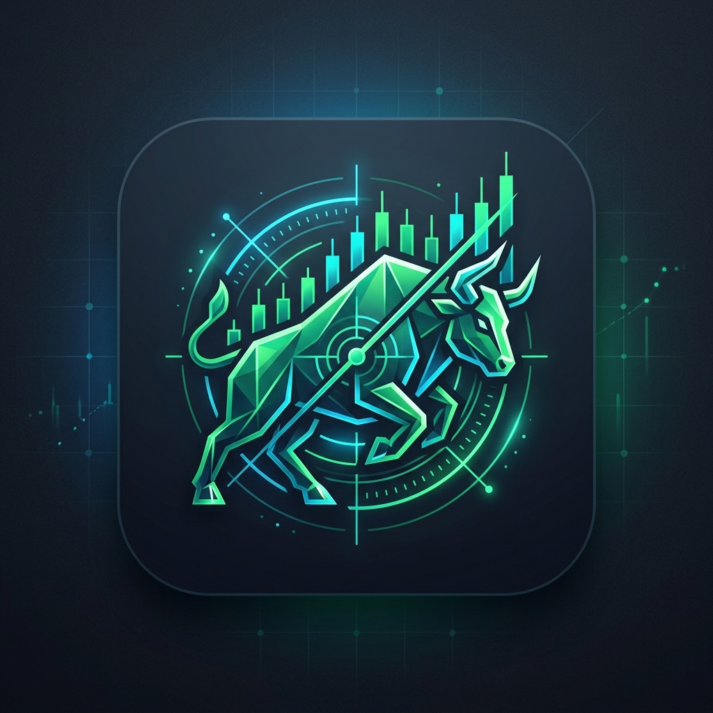

  

# Indian Market Decision Cockpit

> **Disclaimer:** This project is for educational and informational purposes only and is **not investment advice**. The author is **not a SEBI-registered** investment adviser or research analyst. Trading involves risk of loss; do your own research and consult a SEBI-registered adviser before acting on any output.

> Real-time decision-support dashboard for Indian equity markets (NSE/BSE) integrating deterministic quant metrics and institutional money flows.

## 🚀 Features
- **Institutional Flows:** Tracks daily FII & DII cash market trends.
- **Sector Rotation Matrix:** Heatmaps highlighting leading and lagging market sectors.
- **PEAD Screener:** Post-Earnings Announcement Drift candidate detection.
- **Options Strategy Payoff:** Visualizes defined-risk option spreads (bull call, bear put, iron condor) and Greeks.
- **Telegram Trade Alerts:** Automated webhook notifications for high-conviction setups.

## 🛠️ Tech Stack
- Python 3.10+
- Streamlit & Plotly
- Pandas, NumPy
- Telegram Bot API
